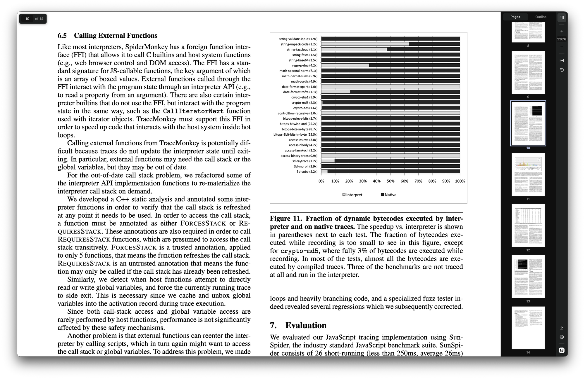

<h1 align="center">PDF+ (browser extension)</h1>

  Acrobat/PDF.js if it wasnt ass and just did the one thing its supposed to do

  <a href="https://github.com/shvm-mane/pdf-plus/releases/latest"><b>DOWNLOAD</b></a>

## what it does

- opens every PDF (web + local) in a fast, minimal viewer
- vim keys: `j` `k` scroll, `gg` `G`, `:` go to page
- one-click [ihatepdf](https://www.ihatepdf.cv/)
- stays snappy on 1000+ page PDfs

## install

**Chromium**
1. download `pdf-plus-chromium.zip` from [releases](https://github.com/shvm-mane/pdf-plus/releases/latest) and unzip it
2. go to `chrome://extensions`, turn on **developer mode**
3. **load unpacked** → pick the unzipped folder
4. open PDF+ **details** → turn on **allow access to file URLs** (for local PDFs) and set **site access** to **on all sites**

## credits

- **[PDF.js](https://github.com/mozilla/pdf.js)** by mozilla (apache 2.0, see `pdfjs/LICENSE`): PDF rendering
- **[Chromium](https://chromium.googlesource.com/chromium/src/+/refs/heads/main/pdf/)** PDF viewer (BSD-3-clause): text selection behaviour, ported to JS

## license

[MIT](LICENSE) (includes PDF.js's and Chromium's notices)
